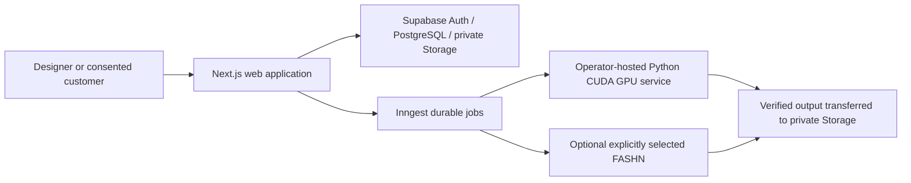

# Architecture

Atelier AI is a modular monolith on Next.js 16 App Router and React 19 with strict TypeScript. The browser owns presentation and temporary selection state. Trusted services own authorization, pricing, storage, provider calls and financial mutations. `server-only` guards elevated modules.

Supabase Auth is verified with `getUser()` rather than trusting browser metadata. Organization membership and role are queried on each protected operation. Tenant RLS and composite foreign keys complement those checks. Elevated storage/database calls receive tenant identifiers derived from verified membership, or from a tightly scoped hashed guest token. Platform access comes from a server-managed registry, never browser roles.

## Generation

`AI_PROVIDER=qwen` selects the default operator-hosted `Qwen/Qwen-Image-Edit-2511` service. An explicit `fashn` selection retains the optional original adapter. Jobs and customer invitations pin their provider/model; changing configuration never reroutes existing customer work. Qwen produces experimental still-image edits and separately enabled customer visualization. It has no video operation. The GPU service is a separate runtime from the Next.js web host.

1. Validate organization, permission, input ownership, model compatibility, options and feature availability.
2. Return a signed quote binding the actor, organization, inputs, settings, price and ten-minute expiry.
3. The SQL reservation locks the credit account and checks the current quoted price, balance, spending limit and idempotency key. The reservation, job and outbox are committed together.
4. Inngest claims a persistent provider slot (global three, one per organization), submits once, saves the prediction ID and uses durable sleeps to poll.
5. Accepted predictions survive browser closure. A potentially accepted request without a saved prediction is held for manual reconciliation, not blindly submitted again.
6. Validate and transfer actual outputs to private storage. Only a stored, verified output can settle the reservation. Failed jobs release credits through an idempotent transaction.

## Payments

The server derives package amount in integer kobo and expected credits from the enabled catalog. Checkout initialization grants no value. Verification checks the provider reference, account email, currency, amount and test/live domain. Signed webhooks and redirect verification both converge on one atomic, idempotent settlement. Refunds use compensating ledger entries and controlled full-package reconciliation.

## Privacy and files

Images are bounded, fully decoded and re-encoded with Sharp to validate real bytes and remove metadata. Random storage keys are generated server-side. Private media uses short-lived signed links. Customer source photos have default 24-hour retention. Guest links store only hashes, expire, allow bounded use and can be revoked. Consent withdrawal blocks output delivery and queues retryable deletion; upstream copies are not claimed erased.

The PWA caches only a public offline page and fixed icons. API responses, authenticated pages and private media are never inserted into its cache. Offline generation is not offered.

## Verification boundaries

Vitest covers domain and adapter behavior with explicit test doubles; PGlite validates actual PostgreSQL constraints, functions and policies. Playwright checks desktop/mobile local flows. Hosted auth, Supabase Storage APIs, independent-connection races, webhook delivery, Inngest execution and live provider capability acceptance require staging credentials. See VERIFICATION.md.
